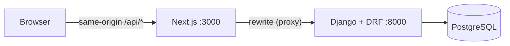
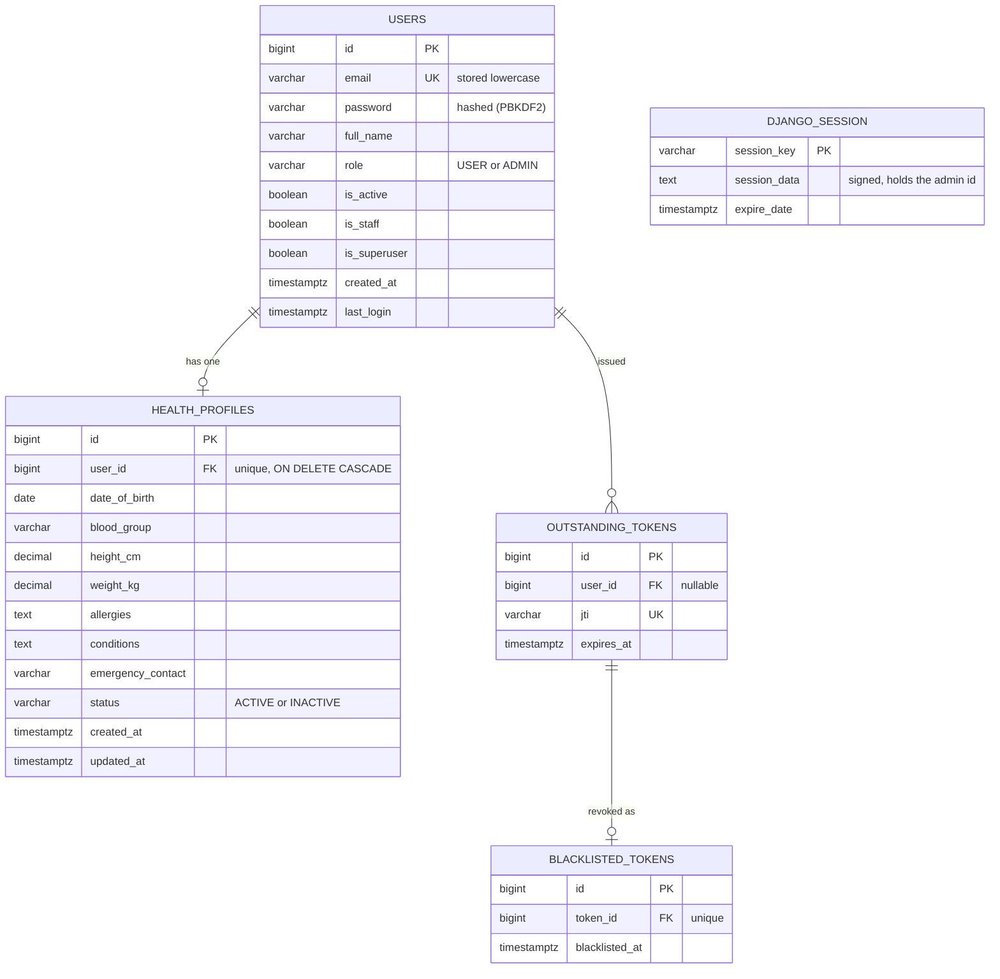

# HealthTech Profile Builder

A small full-stack demo with **two separate authentication flows**:

- **Members** self-register and sign in with **JWT stored in HttpOnly cookies**.
- **Admins** are created from the command line and sign in with **server-side sessions**.

All data is **fictional**. Do not enter real health information.

## Tech stack

| Layer | Technology | Why |
|---|---|---|
| Backend | Django 5.2 + Django REST Framework | Battle-tested password hashing, sessions, CSRF and ORM/migrations |
| JWT | djangorestframework-simplejwt | Short-lived access tokens, refresh rotation and blacklist |
| Database | PostgreSQL | Real constraints, partial/composite indexes, `EXPLAIN ANALYZE` |
| Frontend | Next.js (App Router) + plain CSS | Minimal, accessible, responsive UI; server-side proxy for same-origin cookies |
| Tests | pytest + pytest-django | Readable tests for auth, permissions and constraints |

## Architecture



The browser only talks to Next.js. Next.js forwards `/api/*` to Django, so cookies are first-party and no CORS setup is needed.

## Authentication design

### Members: JWT in HttpOnly cookies

- `POST /api/auth/user/login` validates credentials and sets two cookies: `access_token` (10 minutes, path `/`) and `refresh_token` (1 day, path `/api/auth/`). Both are `HttpOnly` and `SameSite=Lax` (`Secure` in production). **No token is ever returned in the response body.**
- **Where tokens live:** only in HttpOnly cookies, never in `localStorage` or JavaScript memory.
- **How they are sent:** the browser attaches the cookies automatically. A custom DRF authentication class reads the access cookie.
- **Claims:** only `user_id`, `token_type`, `exp`, `iat`, `jti`. Never passwords or secrets. The role is read from the database on every request.
- **Expiry:** an expired access token returns `401`. The frontend calls `POST /api/auth/refresh` once and retries. Refresh tokens **rotate** and the old one is **blacklisted**, so a stolen refresh token only works once.
- **Logout:** `POST /api/auth/user/logout` blacklists the refresh token and clears both cookies. Limitation: an access token that was already copied stays valid until its 10 minutes end (JWTs are stateless), which is why the lifetime is short.
- **CSRF:** cookies are sent automatically, so every state-changing request must include an `X-CSRFToken` header (token from `GET /api/auth/csrf`).

**XSS notes.** If tokens were kept in `localStorage`, any injected script could read and steal them. HttpOnly cookies cannot be read by JavaScript, so an XSS bug cannot exfiltrate them (it could still make requests while the page is open, which is why we also keep output escaped and tokens short-lived). Mitigations in this project: HttpOnly cookies, React's automatic escaping with no `dangerouslySetInnerHTML`, a JSON-only API, `nosniff`/`X-Frame-Options`/`Referrer-Policy` headers, and short token lifetimes. A strict Content-Security-Policy is the recommended next hardening step for production.

### Admins: database-created, session login

- There is **no public admin signup route**. Admins are created with `python manage.py create_admin` (password typed at a hidden prompt, validated by Django's password rules).
- `POST /api/admin/login` (CSRF required) creates a server-side session row in `django_session` and sets the `admin_session` cookie (`HttpOnly`, `SameSite=Lax`, 1 hour). Django rotates the session ID on login (prevents session fixation).
- `POST /api/admin/logout` deletes the session row.
- Every admin endpoint uses **session authentication only** plus a server-side `role == ADMIN` check on each request. Changing a user's role takes effect immediately.
- **Isolation:** a member JWT cannot reach any `/api/admin/*` endpoint, an admin session cannot reach `/api/profiles/me`, and faking cookies, headers or frontend state grants nothing, because the server only trusts the session row.

## Database



`DJANGO_SESSION` has no foreign key: Django stores the logged-in admin's id inside the signed session data.

### Constraints and indexes (each has a use case)

| Index / constraint | Why it exists |
|---|---|
| Unique `users.email` + check `email = lower(email)` | Case-insensitive unique email; fast login lookup |
| Unique `health_profiles.user_id` | One profile per user; fast `GET /profiles/me` |
| Composite `idx_profile_status_created_id` on `(status, created_at DESC, id DESC)` | Admin list "profiles by status, newest first, one page" with a stable tie-breaker for pagination |
| Check constraints (role, status, positive height/weight) | The database rejects bad data even if application code is bypassed |
| `ON DELETE CASCADE` on profile → user | A profile never outlives its owner |

Name/email search uses `icontains`, which a normal index cannot speed up. No index was added for it (no demonstrated need). If search ever becomes slow at scale, PostgreSQL `pg_trgm` is the upgrade path.

### EXPLAIN evidence

```powershell
cd backend
python manage.py seed_data --count 5000
python manage.py explain_admin_list
python manage.py explain_admin_list --without-index
```

Saved plans are in `docs/explain-with-index.txt` and `docs/explain-without-index.txt`. With the index the plan uses an index scan; without it, a sequential scan plus sort.

## API reference

Base path: `/api`. All bodies are JSON. State-changing requests need the `X-CSRFToken` header (from `GET /api/auth/csrf` or `/api/admin/csrf`).

| Method | Path | Auth | Purpose |
|---|---|---|---|
| GET | `/auth/csrf` | none | CSRF token + cookie |
| POST | `/auth/signup` | none | Register a member |
| POST | `/auth/user/login` | none | Member login (sets JWT cookies) |
| POST | `/auth/refresh` | refresh cookie + CSRF | Rotate tokens |
| POST | `/auth/user/logout` | CSRF | Revoke refresh token, clear cookies |
| GET | `/profiles/me` | member JWT cookie | View own profile |
| PATCH | `/profiles/me` | member JWT cookie + CSRF | Edit own profile |
| GET | `/admin/csrf` | none | CSRF token + cookie |
| POST | `/admin/login` | CSRF | Admin login (sets session cookie) |
| POST | `/admin/logout` | admin session + CSRF | Destroy session |
| GET | `/admin/me` | admin session | Current admin |
| GET | `/admin/profiles?search=&status=&page=&page_size=` | admin session | List/search profiles |
| GET | `/admin/profiles/{id}` | admin session | Profile details |
| PATCH | `/admin/profiles/{id}/deactivate` | admin session + CSRF | Set status INACTIVE |
| PATCH | `/admin/profiles/{id}/reactivate` | admin session + CSRF | Set status ACTIVE |

Unauthenticated requests return `401`; authenticated users without the right role or a missing CSRF token return `403`.

### Samples

`POST /api/auth/signup`

```json
{ "full_name": "Sara Demo", "email": "sara@example.com", "password": "Str0ng!Pass#2026" }
```

```json
201 { "id": 7, "email": "sara@example.com", "full_name": "Sara Demo" }
400 { "email": ["An account with this email already exists."] }
```

`POST /api/auth/user/login` (sets `access_token` and `refresh_token` cookies)

```json
{ "email": "sara@example.com", "password": "Str0ng!Pass#2026" }
```

```json
200 { "user": { "id": 7, "email": "sara@example.com", "full_name": "Sara Demo" } }
401 { "detail": "Invalid email or password." }
```

`GET /api/profiles/me`

```json
200 {
  "id": 7, "full_name": "Sara Demo", "email": "sara@example.com",
  "date_of_birth": "1995-04-12", "blood_group": "O+",
  "height_cm": "172.5", "weight_kg": "64.0",
  "allergies": "Fictional pollen sensitivity", "conditions": "",
  "emergency_contact": "Fictional Contact 555-0100",
  "status": "ACTIVE",
  "created_at": "2026-10-17T09:30:00Z", "updated_at": "2026-10-17T09:41:12Z"
}
```

`PATCH /api/profiles/me`

```json
{ "blood_group": "O+", "height_cm": "172.5" }
```

```json
200 (updated profile, same shape as above)
400 { "height_cm": ["Height must be between 30 and 272 cm."] }
403 { "detail": "This profile has been deactivated." }
```

`POST /api/admin/login`

```json
{ "email": "admin@example.com", "password": "<admin password>" }
```

```json
200 { "user": { "id": 4, "email": "admin@example.com", "full_name": "Demo Admin", "role": "ADMIN" }, "csrfToken": "..." }
401 { "detail": "Invalid email or password." }
```

`GET /api/admin/profiles?status=ACTIVE&page=1&page_size=10`

```json
200 {
  "count": 25, "next": "...?page=2", "previous": null,
  "results": [
    { "id": 7, "user_id": 7, "full_name": "Sara Demo", "email": "sara@example.com",
      "blood_group": "O+", "status": "ACTIVE", "created_at": "2026-10-17T09:30:00Z" }
  ]
}
```

## Run locally (Windows PowerShell)

Requirements: Python 3.12+, PostgreSQL 16+, Node.js 20.9+.

```powershell
# 1. Database (in psql as the postgres user)
#    CREATE USER healthtech_user WITH PASSWORD 'devpassword123';
#    CREATE DATABASE healthtech_db OWNER healthtech_user;
#    ALTER USER healthtech_user CREATEDB;

# 2. Backend
cd backend
python -m venv venv
.\venv\Scripts\Activate.ps1
pip install -r requirements.txt
Copy-Item .env.example .env        # then fill in DJANGO_SECRET_KEY and DATABASE_URL
python manage.py migrate
python manage.py create_admin --email admin@example.com --full-name "Demo Admin"
python manage.py seed_data --count 30
python manage.py runserver

# 3. Frontend (second terminal)
cd frontend
npm install
npm run dev
```

Open `http://localhost:3000` (use `localhost`, not `127.0.0.1`).

### Environment variables (`backend/.env.example`)

| Variable | Purpose |
|---|---|
| `DJANGO_SECRET_KEY` | Signs cookies, sessions and JWTs. Long and random. Never commit the real value. |
| `DJANGO_DEBUG` | `True` for local development only |
| `DJANGO_ALLOWED_HOSTS` | Hostnames Django will serve |
| `DATABASE_URL` | PostgreSQL connection string |
| `JWT_COOKIE_SECURE` | `False` on local HTTP, `True` in production (also applies to session and CSRF cookies) |
| `CSRF_TRUSTED_ORIGINS` | Frontend origins allowed to send state-changing requests |

The frontend can optionally use `BACKEND_URL` (default `http://127.0.0.1:8000`).

## Tests

```powershell
cd backend
pytest -v
```

The suite covers signup validation, duplicate emails, hashed passwords, JWT expiry/tampering/wrong type, refresh rotation and blacklist, logout, CSRF enforcement, cross-user isolation, admin-only endpoints, session expiry and logout, role changes taking effect immediately, and that user JWTs never grant admin access.

Frontend checks: `npm run lint`, `npm run build`, and the manual accessibility/responsive checklist.

## Security notes and known limitations

- Secrets live in environment variables; `.env` is git-ignored.
- Passwords are hashed with Django's PBKDF2 and validated against Django's password rules.
- Login errors are generic. Signup reveals that an email is taken (required by the duplicate-email behavior).
- Not implemented (good production next steps): login rate limiting/lockout, a strict Content-Security-Policy, audit logging of admin actions, email verification, HTTPS and secure deployment settings, `pg_trgm` for large-scale search.

## Acceptance checklist

| Requirement | Where it is shown |
|---|---|
| Member signup + JWT login | `/api/auth/*`, `tests/test_auth_user.py` |
| Admin provisioning + session login | `create_admin`, `/api/admin/*`, `tests/test_admin_auth.py` |
| Isolated permissions | `test_user_jwt_does_not_grant_admin_access`, `test_admin_session_cannot_use_user_endpoints` |
| Profile CRUD (own profile) | `/api/profiles/me`, `tests/test_profile_me.py` |
| Admin list/search/detail/deactivate | `/api/admin/profiles*`, `tests/test_admin_profiles.py` |
| Migrations and justified indexes | `accounts/migrations`, `profiles/migrations`, `docs/explain-*.txt` |
| Documented APIs | This README |
| Synthetic data only | `seed_data`, UI notices |
| Basic tests | `backend/tests` |
