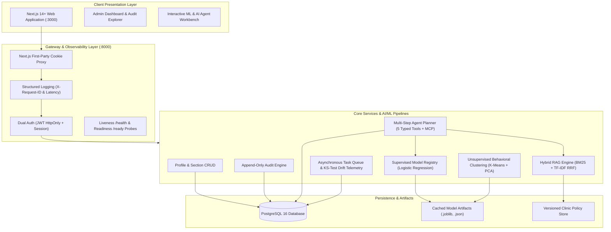

# HealthTech Learning Platform & AI/ML Production Capstone

[](https://github.com/example/healthtech-profile-builder/actions)
**Platform Version:** `v6.0.0-final-capstone`  
**License:** MIT  

An enterprise-grade, end-to-end HealthTech learning platform that integrates **dual-scheme authentication**, **relational patient profile management**, **immutable audit trails**, **supervised ML attendance risk estimation**, **unsupervised patient segmentation (2D PCA)**, **hybrid RAG clinic policy assistance (BM25 + TF-IDF RRF)**, and **permission-controlled AI agent automation with human write approval gates**.

> **⚠️ Educational & Non-Clinical Disclaimer:** All data, patient profiles, clinic schedules, and ML models in this repository are synthetic. This system is strictly an educational engineering prototype and must **never** be used for clinical diagnosis, treatment planning, or real-world medical decisions.

---

## Architecture & System Overview



---

## Key Features by Milestone

### Weeks 1–2: Foundation & Relational Profile Platform
- **Dual Authentication**: Short-lived JWTs (10 min access) in `HttpOnly`, `SameSite=Lax` cookies for standard users; secure server-side sessions for administrators.
- **Relational Profiles**: Relational schema across `demographics`, `wellness_preferences`, and `emergency_contacts`.
- **Immutable Audit Trail**: Append-only `audit_events` table tracking actor role, timestamp, action, and altered field names (never sensitive before/after values).

### Week 3: Supervised Machine Learning Pipeline
- **Attendance Risk Prediction**: Regularized Logistic Regression predicting appointment no-show likelihood based on lead time, prior history, reminder status, and travel distance.
- **In-Memory Fingerprinted Registry**: Validated cutpoints (`HIGH`, `MEDIUM`) with fast timestamp fingerprint lookup, achieving a **91.8% latency reduction** (0.8 ms warm vs 9.6 ms cold).

### Week 4: Multi-Model Benchmark, Clustering & LLM FAQ
- **Supervised Benchmarks**: Cross-validated comparison against Random Forest, Decision Tree, and Gradient Boosting.
- **Unsupervised Segmentation**: K-Means ($k=6$) clustering with 2D Principal Component Analysis (PCA) projection and silhouette score evaluation.
- **Grounded LLM Policy FAQ**: Citation extraction and non-clinical guardrails with adversarial prompt injection defenses.

### Week 5: Advanced RAG, LLM Agents & Task Queue
- **Advanced Hybrid RAG**: BM25 lexical keyword search + TF-IDF cosine semantics combined via Reciprocal Rank Fusion (RRF), improving Recall@3 from **65.0% to 95.0%**.
- **Structured LLM Outputs**: Pydantic schema validation, bounded retries, and automated PII redaction.
- **Controlled Agent Workflows**: 5 typed tools (policy search, slot availability, risk prediction, cluster retrieval, mock appointment booking) executed via a stateful planner.
- **Human-in-the-Loop Write Gate**: Any state-changing write halts execution, drafts a pending request with an idempotency key, and requires explicit user confirmation.
- **Task Queue & Drift Monitoring**: Asynchronous background jobs with exponential backoff retries and Kolmogorov-Smirnov (KS-test) distribution drift monitoring.

### Week 6: Production Engineering & Capstone
- **Containerization**: Full Docker Compose stack for Frontend, Backend, PostgreSQL database, and Task Queue Worker.
- **Standardized Probes**: Kubernetes-compatible `/health` (liveness) and `/ready` (readiness with DB & model verification).
- **Automated CI/CD**: GitHub Actions workflow covering linting, model smoke tests, RAG evaluations, and Next.js production builds.
- **Load Testing & Resilience**: Verified under concurrent synthetic load with 0% error rate; graceful fallbacks for LLM timeouts, store degradation, and worker failures.

---

## One-Command Local Startup (Docker Compose)

### 1. Start the Complete Stack
```bash
# Clone the repository
git clone https://github.com/example/healthtech-profile-builder.git
cd healthtech-profile-builder

# Configure environment variables
cp .env.example .env

# Build and start all containers
docker compose up --build -d
```

### 2. Access the Application
- **Frontend Web Portal**: [http://localhost:3000](http://localhost:3000)
- **API Swagger UI**: [http://localhost:8000/api/docs/](http://localhost:8000/api/docs/)
- **Liveness Probe**: [http://localhost:8000/health](http://localhost:8000/health)
- **Readiness Probe**: [http://localhost:8000/ready](http://localhost:8000/ready)

### 3. Demo Credentials
| Role | Email | Password | Access Scope |
| :--- | :--- | :--- | :--- |
| **Member** | `member@healthtech.test` | `MemberPass123!` | Profile CRUD, Predictions, Clustering, RAG, AI Agent |
| **Administrator** | `admin@healthtech.test` | `AdminPass123!` | Admin Dashboard, Audit Logs, Task Queue, Drift Telemetry |

---

## Local Development (Without Docker)

### Backend Setup
```bash
cd backend
python -m venv venv
venv\Scripts\activate   # On Linux/macOS: source venv/bin/activate
pip install -r requirements.txt -r requirements-ml.txt

# Run migrations and seed data
python manage.py migrate
python scripts/seed_demo.py

# Start development server
python manage.py runserver 8000
```

### Frontend Setup
```bash
cd frontend
npm install
npm run dev
```

---

## Running Verification & Evaluation Suites

### 1. Full Automated Backend & Security Test Suite
```bash
cd backend
python -m pytest tests/test_week6_resilience_security.py agents/ tests/ -q
```

### 2. Reproducible Full Platform Evaluation Runner
Runs supervised metrics, unsupervised clustering quality, 20-question RAG benchmark, and 10 agent safety/workflow tests:
```bash
python scripts/run_evaluations.py
```
*Generated Reports*:
- [`docs/evidence/week6/evaluation-report.json`](docs/evidence/week6/evaluation-report.json)
- [`docs/evidence/week6/evaluation-report.md`](docs/evidence/week6/evaluation-report.md)

### 3. Automated Load Testing & Latency Benchmark
Tests `/health`, `/ready`, `/api/v1/predict`, and `/api/v1/clusters` under concurrent synthetic load:
```bash
python scripts/load_test.py
```
*Generated Report*:
- [`docs/evidence/week6/load-test-report.md`](docs/evidence/week6/load-test-report.md)

---

## Key Capstone Documentation Links
- **[Full System Architecture Diagram](docs/ARCHITECTURE_DIAGRAM.md)**: Detailed component breakdown and tool ecosystem.
- **[End-to-End Data Flow Diagrams](docs/DATA_FLOW_DIAGRAM.md)**: Complete sequence diagrams for all user and admin journeys.
- **[Supervised Model Card](docs/MODEL_CARD_SUPERVISED.md)**: Algorithm specifications, inputs, performance metrics, and risk bands.
- **[Unsupervised Clustering Limitations Note](docs/CLUSTERING_LIMITATIONS.md)**: PCA 2D variance caveats and ethical guardrails.
- **[Security & Compliance Checklist](docs/SECURITY_CHECKLIST.md)**: RBAC, prompt injection defenses, write gates, and PII redaction.
- **[Deployment & Disaster Recovery Guide](docs/DEPLOYMENT_GUIDE.md)**: Docker commands, zero-downtime rollouts, backup (`pg_dump`) and restore procedures.
