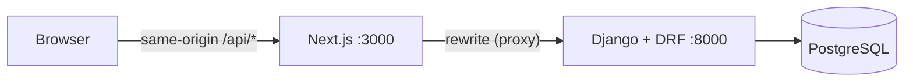
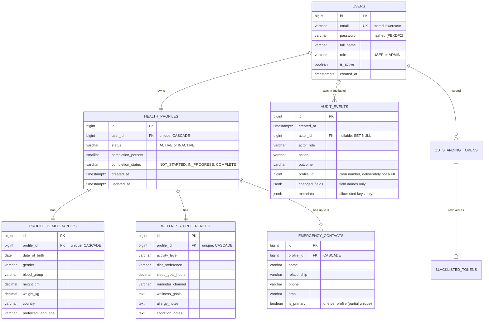

# HealthTech Profile Builder

A full-stack demo with **two separate authentication flows**, a relational patient-profile model, and an **audit trail**:

- **Members** self-register and sign in with **JWT stored in HttpOnly cookies**.
- **Admins** are created from the command line and sign in with **server-side sessions**.

All data is **fictional**. Do not enter real health information.

## Features

- Member sections: demographics, up to three emergency contacts (one primary), wellness preferences, and a stored **profile completion** status
- Admin dashboard: search, filters (status, completion, dates), ordering, pagination, read-only profile details, deactivate and reactivate
- **Audit events** for member edits and admin actions: who, what kind, which profile, which **field names** changed. Never the values
- OpenAPI/Swagger documentation, EXPLAIN evidence for indexed lookups, and a large automated test suite
- Accessible, responsive interface with dark mode

## Tech stack

| Layer | Technology | Why |
|---|---|---|
| Backend | Django 5.2 + Django REST Framework | Password hashing, sessions, CSRF, ORM and migrations built in |
| JWT | djangorestframework-simplejwt | Short-lived access tokens, rotation and blacklist |
| Filtering | django-filter | Declarative, validated filters shown in the API docs |
| API docs | drf-spectacular (+ sidecar) | OpenAPI schema and self-hosted Swagger UI |
| Database | PostgreSQL | Real constraints, partial and composite indexes, `EXPLAIN ANALYZE` |
| Frontend | Next.js (App Router) + plain CSS | Server-side proxy gives same-origin cookies |
| Tests | pytest + pytest-django | Auth, permissions, constraints, audit and docs |

## Architecture



The browser only talks to Next.js. Next.js forwards `/api/*` to Django, so cookies are first-party and no CORS setup is needed.

## Authentication design

### Members: JWT in HttpOnly cookies

- `POST /api/auth/user/login` sets `access_token` (10 minutes, path `/`) and `refresh_token` (1 day, path `/api/auth/`). Both are `HttpOnly`, `SameSite=Lax` (`Secure` in production). **No token is ever returned in a response body** and none is stored in `localStorage`.
- A custom DRF authentication class reads the access cookie. Claims are only `user_id`, `token_type`, `exp`, `iat`, `jti`. The role is read from the database on every request.
- Expiry: `401` on an expired token, then the frontend calls `POST /api/auth/refresh` once and retries. Refresh tokens **rotate** and the old one is **blacklisted**. Logout revokes the refresh token and clears both cookies. An access token already copied stays valid until its 10 minutes end (JWTs are stateless), so the lifetime is short.
- CSRF: state-changing requests need an `X-CSRFToken` header (token from `GET /api/auth/csrf`).
- XSS: HttpOnly cookies cannot be read by injected scripts. Further mitigations: React's automatic escaping (no `dangerouslySetInnerHTML`), a JSON-only API, `nosniff`, `X-Frame-Options` and `Referrer-Policy` headers, and short token lifetimes. A strict Content-Security-Policy is the recommended next hardening step.

### Admins: database-created, session login

- There is **no public admin signup**. Admins are created with `python manage.py create_admin`.
- `POST /api/admin/login` (CSRF required) creates a server-side session row and sets the `admin_session` cookie (`HttpOnly`, `SameSite=Lax`, 1 hour). Django rotates the session id on login.
- Every admin endpoint uses **session authentication only** plus a server-side `role == ADMIN` check per request. Demoting an admin takes effect immediately.
- **Isolation:** a member JWT cannot reach any `/api/admin/*` endpoint, an admin session cannot reach member endpoints, and faked cookies, headers or frontend state grant nothing.

### Horizontal privilege escalation

Member routes never accept a profile id. Everything is resolved through the logged-in user, and an emergency contact is looked up only among **that member's own** contacts, so another member's id returns `404`. A route-matrix test crosses every endpoint with four callers (anonymous, member A, member B, admin).

## Database



`django_session` (admin sessions) has no foreign key: Django stores the admin's id inside the signed session data. Audit events keep `profile_id` as a plain number so the log outlives the profile it describes.

### Constraints

- Case-insensitive unique email (unique + a check that the stored email is lowercase)
- One primary contact per profile (partial unique index); no duplicate phone per profile (partial unique index ignoring blanks); at most three contacts (enforced in a transaction that locks the profile row)
- Check constraints for ranges (height, weight, sleep goal), valid choices, and `completion_percent` always agreeing with `completion_status`
- Audit events are **append-only**: the model and manager refuse updates and deletes (in production also revoke `UPDATE`/`DELETE` on the table from the app's database user)

### Indexes (each tied to a query)

| Index | Query it serves |
|---|---|
| Unique `users.email` | Login lookup; duplicate check |
| Unique `profile_id` on each one-to-one section | Loading a member's own sections |
| `idx_profile_status_created_id` on `(status, created_at DESC, id DESC)` | Admin list: profiles by status, newest first, stable paging |
| Partial unique indexes on `emergency_contacts` | Contact rules above; finding the primary contact |
| `idx_audit_profile_newest` on `(profile_id, id DESC)` | **One profile's audit timeline** |
| `idx_audit_action_newest` on `(action, id DESC)` | Audit feed filtered by action |

The audit feed's default view (newest first, unfiltered) is served by the primary key, because ids grow with time in an append-only table. Name and email search uses `icontains`, which a normal index cannot serve. No index was added for it (no demonstrated need); `pg_trgm` is the upgrade path at scale.

### EXPLAIN evidence

```powershell
cd backend
python manage.py seed_data --count 5000
python manage.py explain_admin_list
python manage.py explain_admin_list --without-index
python manage.py seed_audit_events --count 50000
python manage.py explain_audit_timeline
python manage.py explain_audit_timeline --without-index
```

Saved plans live in `docs/explain-with-index.txt`, `docs/explain-without-index.txt`, `docs/explain-audit-with-index.txt` and `docs/explain-audit-without-index.txt`. With the index the plans use an index scan. Without it, PostgreSQL falls back to a sequential scan with a sort, or walks the primary key and discards non-matching rows.

## Audit events

Recorded: member edits (demographics, wellness, emergency contacts) and admin actions (login, failed login, logout, profile viewed, search performed, deactivate, reactivate). Each event stores the actor id and role, the action, the outcome, the profile id and the **names** of changed fields. Never stored: saved values, passwords, tokens, search terms or attempted login emails.

- One function (`record_event`) is the only writer, with allowlists for field names and metadata keys. Anything else is refused, and error messages never echo the rejected value.
- Events are written in the **same transaction** as the change, so there is no edit without a record. A test forces the audit write to fail and checks that the edit rolls back.
- Admin audit endpoints are read-only and use cursor pagination.

## API documentation

- Interactive docs (development only): `http://127.0.0.1:8000/api/docs/` (Swagger UI) and `/api/redoc/`. They are not served when `DEBUG` is off.
- The generated schema is committed as `docs/openapi.yaml`. Regenerate it with:

```powershell
cd backend
python manage.py spectacular --file ..\docs\openapi.yaml --validate
```

A test fails if a public endpoint is undocumented, an operation lacks a summary or tag, a state-changing operation does not document the CSRF header, or a password appears in a response schema.

## API reference

All bodies are JSON. State-changing requests need `X-CSRFToken`. Unauthenticated requests return `401`. A signed-in caller without the right role, a missing CSRF token or a deactivated profile returns `403`.

| Method | Path | Auth |
|---|---|---|
| GET | `/api/auth/csrf`, `/api/admin/csrf` | none |
| POST | `/api/auth/signup` | none |
| POST | `/api/auth/user/login` | none |
| POST | `/api/auth/refresh` | refresh cookie + CSRF |
| POST | `/api/auth/user/logout` | CSRF |
| GET | `/api/profiles/me` | member JWT |
| GET, PATCH, DELETE | `/api/profiles/me/demographics` | member JWT (+ CSRF for writes) |
| GET, PATCH, DELETE | `/api/profiles/me/wellness` | member JWT (+ CSRF for writes) |
| GET, POST | `/api/profiles/me/emergency-contacts` | member JWT (+ CSRF for POST) |
| GET, PATCH, DELETE | `/api/profiles/me/emergency-contacts/{id}` | member JWT (+ CSRF for writes) |
| POST | `/api/admin/login` | CSRF |
| POST | `/api/admin/logout` | admin session + CSRF |
| GET | `/api/admin/me` | admin session |
| GET | `/api/admin/profiles?search=&status=&completion_status=&created_after=&created_before=&ordering=&page=&page_size=` | admin session |
| GET | `/api/admin/profiles/{id}` | admin session |
| PATCH | `/api/admin/profiles/{id}/deactivate` and `/reactivate` | admin session + CSRF |
| GET | `/api/admin/audit-events?action=&outcome=&actor_id=&profile_id=&created_after=&created_before=&cursor=&page_size=` | admin session |
| GET | `/api/admin/profiles/{id}/audit-events` | admin session |

### Samples

`GET /api/profiles/me` (member)

```json
{
  "id": 7,
  "full_name": "Sara Demo",
  "email": "sara@example.com",
  "status": "ACTIVE",
  "completion": {
    "percent": 50,
    "status": "IN_PROGRESS",
    "missing": [
      { "key": "emergency_contact", "label": "An emergency contact with a phone number" },
      { "key": "primary_contact", "label": "A primary emergency contact" }
    ]
  },
  "demographics": { "date_of_birth": "1995-04-12", "gender": "FEMALE", "blood_group": "O+", "height_cm": "172.5", "weight_kg": "64.0", "country": "Canada", "preferred_language": "English", "updated_at": "2026-10-21T09:41:12Z" },
  "emergency_contacts": [],
  "wellness": { "activity_level": "", "diet_preference": "", "sleep_goal_hours": null, "reminder_channel": "", "wellness_goals": "", "allergy_notes": "", "condition_notes": "", "updated_at": "2026-10-21T09:30:00Z" },
  "created_at": "2026-10-21T09:30:00Z",
  "updated_at": "2026-10-21T09:30:00Z"
}
```

`PATCH /api/profiles/me/demographics`

```json
{ "country": "Canada", "height_cm": "172.5" }
```

```json
200 (updated section)
400 { "height_cm": ["Height must be between 30 and 272 cm."] }
403 { "detail": "This profile has been deactivated." }
```

`POST /api/profiles/me/emergency-contacts`

```json
{ "name": "Fictional Helper", "relationship": "FRIEND", "phone": "555-0101" }
```

```json
201 { "id": 31, "name": "Fictional Helper", "relationship": "FRIEND", "phone": "555-0101", "email": "", "is_primary": true, "created_at": "...", "updated_at": "..." }
400 { "non_field_errors": ["You can save at most 3 emergency contacts."] }
400 { "phone": ["This phone number is already saved for another contact."] }
404 (another member's contact id)
```

`GET /api/admin/profiles?completion_status=IN_PROGRESS&ordering=-completion_percent`

```json
{
  "count": 12, "next": "...?page=2", "previous": null,
  "results": [
    { "id": 7, "user_id": 7, "full_name": "Sara Demo", "email": "sara@example.com", "status": "ACTIVE", "completion_percent": 50, "completion_status": "IN_PROGRESS", "created_at": "2026-10-21T09:30:00Z" }
  ]
}
```

`GET /api/admin/audit-events`

```json
{
  "next": "...?cursor=cD0xMDQy", "previous": null,
  "results": [
    { "id": 1042, "created_at": "2026-10-21T10:15:03Z", "actor_id": 12, "actor_role": "USER", "action": "EMERGENCY_CONTACT_UPDATED", "outcome": "SUCCESS", "profile_id": 12, "changed_fields": ["phone", "relationship"], "metadata": { "section": "emergency_contacts", "contact_id": 31 } }
  ]
}
```

## Run locally (Windows PowerShell)

Requirements: Python 3.12+, PostgreSQL 16+, Node.js 20.9+.

```powershell
# 1. Database (in psql as the postgres user)
#    CREATE USER healthtech_user WITH PASSWORD 'devpassword123';
#    CREATE DATABASE healthtech_db OWNER healthtech_user;
#    ALTER USER healthtech_user CREATEDB;

# 2. Backend
cd backend
python -m venv venv
.\venv\Scripts\Activate.ps1
pip install -r requirements.txt
Copy-Item .env.example .env        # then fill in DJANGO_SECRET_KEY and DATABASE_URL
python manage.py migrate
python manage.py create_admin --email admin@example.com --full-name "Demo Admin"
python manage.py seed_data --count 30
python manage.py runserver

# 3. Frontend (second terminal)
cd frontend
npm install
npm run dev
```

Open `http://localhost:3000` (use `localhost`, not `127.0.0.1`).

| Variable | Purpose |
|---|---|
| `DJANGO_SECRET_KEY` | Signs cookies, sessions and JWTs. Long, random, never committed |
| `DJANGO_DEBUG` | `True` for local development only (also enables the API docs routes) |
| `DJANGO_ALLOWED_HOSTS` | Hostnames Django serves |
| `DATABASE_URL` | PostgreSQL connection string |
| `JWT_COOKIE_SECURE` | `False` on local HTTP, `True` in production (also applies to session and CSRF cookies) |
| `CSRF_TRUSTED_ORIGINS` | Frontend origins allowed to send state-changing requests |

The frontend optionally reads `BACKEND_URL` (default `http://127.0.0.1:8000`).

## Tests

```powershell
cd backend
pytest -v
```

Coverage includes: signup validation, hashed passwords, JWT expiry, tampering and wrong type, refresh rotation, logout, CSRF, cross-user isolation, admin-only routes, session expiry, role changes taking effect immediately, a 72-case route matrix, section validation, the three-contact rule, completion, data migration, audit events (field names only, no leaked values, atomic with the edit, append-only), cursor pagination, filters, and API documentation checks.

Frontend checks: `npm run lint`, `npm run build`, and the manual accessibility and responsive checklist.

## Security notes and known limitations

- Secrets live in environment variables; `.env` is git-ignored.
- Login errors are generic. Signup reveals that an email is taken.
- Not implemented (good production next steps): login rate limiting and lockout, a strict Content-Security-Policy, email verification, HTTPS and secure deployment settings, revoking `UPDATE`/`DELETE` on the audit table from the app's database user, audit retention policy, `pg_trgm` for large-scale search.

## Acceptance checklist

| Requirement | Evidence |
|---|---|
| Signup + JWT login; admin provisioning + session login | `/api/auth/*`, `create_admin`, `/api/admin/*` |
| User cannot access another user's profile or admin routes | Route matrix and cross-user tests |
| Admin session and user JWT paths remain distinct | Matrix rows for every route, `test_admin_auth.py` |
| Patient sections: demographics, emergency contact, wellness, completion | `profiles` models, member endpoints, tests |
| User-owned CRUD; admin-only listing/search | `/api/profiles/me/*`, `/api/admin/profiles` |
| Audit events excluding secrets and sensitive payloads | `audit` app and its leak-hunting tests |
| Pagination, filtering, migrations, API documentation | Page and cursor pagination, `django-filter`, migrations `0001`-`0005`, `docs/openapi.yaml` |
| Migrations, indexes and EXPLAIN evidence | Index table above, `docs/explain-*.txt` |
| Hashed passwords, JWT expiry/refresh, secure token storage, CSRF for admin sessions | Authentication design above |

---

## Week 3 Feedback & Re-Review Additions (`week3-feedback-fixes` branch)

In response to reviewer feedback, this branch introduces hardened metadata validation and comprehensive demo evidence:

### 1. Robust Metadata Validation & 503 Recovery
- **Before:** If `noshow-1.0.0.meta.json` was non-dict (e.g. `[]` or `null`) or missing required fields, `metadata.get()` threw unhandled `AttributeError`, returning `500 Internal Server Error`.
- **After:** `backend/mlcore/registry.py` strictly validates that metadata is a JSON object and verifies all mandatory fields (`artifact_sha256`, `model_version`, `schema_version`, `threshold`, `risk_band_cutpoints`) *before* caching.
- **503 Instead of 500:** Invalid metadata raises `ModelUnavailable` and returns HTTP `503 Service Unavailable`.
- **Dynamic Recovery:** When the artifact metadata is repaired, subsequent requests succeed with `200 OK` immediately without requiring a server reboot.

### 2. Regression Tests Added
- `backend/mlcore/tests/test_ml_registry.py`:
  - `test_non_object_metadata_is_refused_and_recovers`
  - `test_missing_required_metadata_fields_is_refused_and_recovers`
- `backend/predictions/tests/test_api.py`:
  - `test_malformed_metadata_gives_503_and_recovers`
- `backend/tests/test_predictions_auth.py`:
  - `test_malformed_metadata_returns_503_not_500_and_recovers`

### 3. Re-Review Artifacts
- **Week 3 PR Documentation:** `docs/WEEK3_PR.md` containing clean-clone commands, digests, authenticated and denied request examples, AI prompt tracking, and verification evidence.
- **Model Card:** `docs/ml/MODEL_CARD.md` containing exact AP, dummy prevalence, cutoffs, and confusion matrix error analysis.
