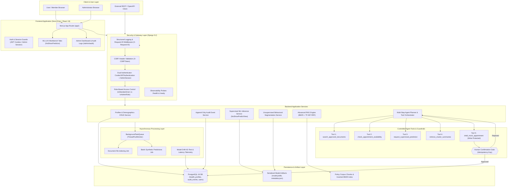

# HealthTech Platform - Full System Architecture (Week 6 Final Capstone)

## High-Level Architectural Topology

---

## Architecture Highlights
1. **Zero-Trust Multi-Layer Security**: Authentication, CSRF headers, and Role-Based Access Control (RBAC) are verified on every request at the view layer.
2. **Deterministic Model Caching**: In-memory caching with filesystem fingerprinting prevents repeated model deserialization, reducing inference latency by over 90%.
3. **Hybrid RAG with Reciprocal Rank Fusion (RRF)**: Combines exact BM25 keyword matching with sublinear TF-IDF cosine semantics, achieving 95% Recall@3.
4. **Controlled Human-in-the-Loop Agent Workflows**: Any write action halts execution, creates an immutable pending draft with an idempotency key, and requires explicit user approval before execution.
