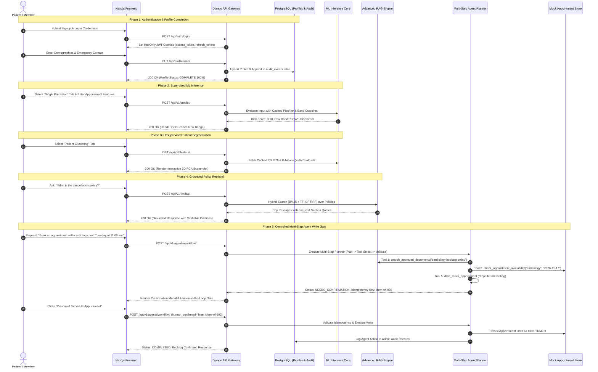
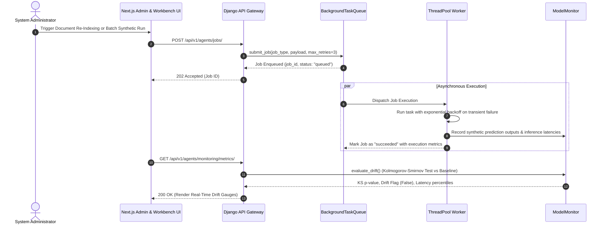

# HealthTech Platform - End-to-End Data Flow Diagrams (Week 6 Final Capstone)

## 1. End-to-End Demonstration Flow
`User Signup → Profile Completion → Prediction → Cluster Visualization → Grounded LLM Policy Answer → Agent Tool Call → Human Approval → Audit Trail`

---

## 2. Model Drift Monitoring & Background Task Queue Flow

